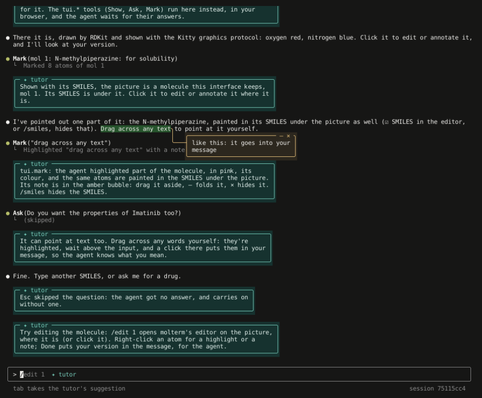

# molterm agent

A Claude Code-like terminal interface for an agent that runs on the server, one agent per session. The interface is Python
(`tui/molterm_tui`), run in the browser by [Pyodide](https://pyodide.org/) and drawn in [restty](https://github.com/wiedymi/restty); the
server is Flask. The agent uses the interface as one of its tools: it can put a panel in the user's transcript, and ask the user a
question and wait for the answer. For now the agent is an emulation, a script that behaves like a model would, to show the pieces
working: it draws molecules with the molterm server and shows them as pictures (the Kitty graphics protocol, which restty draws), and
asks before showing their properties.


**To write an agent of your own** and run it on the server or anywhere else, see [TUTORIAL.md](TUTORIAL.md): a base class (`sdk/tuiagent`,
the standard library only), an example agent, and one with Claude behind it.

## Run it

Docker only, from this folder, with the molterm dev server running (the agent draws with it):

```sh
make dev                 # build and start -> http://molterm-agent-dev.localhost, against the dev molterm server
make test                # the tests, in the container
make build up ENV=prod   # production -> http://molterm-agent.localhost, against the production molterm server
```

`make agent-gif` in the main folder records the demos above from the running dev agent (`docs/screenshots/agent_gif.py` and
`agent_features.py`, in headless Chromium).

A real domain goes in a git-ignored `env/<env>.local.env`, as for the other services (see the main README). The image fetches Pyodide
0.28.3 (Python 3.13, as the server), restty and the DejaVu fonts from npm at build time, each checked against its sha256.

## How it fits together

```
 browser                                                      server (Flask, one process)
 ┌─────────────────────────────────────────────┐              ┌────────────────────────────────────────────┐
 │ restty ── keys ──> molterm_tui.App (Pyodide)│ ── POST ───> │ session ── inbox ──> agent thread          │
 │        <── screen ──┘   │   ▲               │   messages,  │   │                     │  server tools:     │
 │                         │   └── events ─────│ <─ SSE ───── │ event log <── emits ────┤  molterm.render,   │
 │          tui.show, tui.ask answers ─────────│ ── POST ───> │ tool results ──> wakes ─┘  molterm.properties│
 └─────────────────────────────────────────────┘              └────────────────────────────────────────────┘
```

- `POST /api/v1/sessions` makes a session and starts its agent in a thread. Sessions live in memory (gunicorn runs one worker with
  threads), end after 30 minutes unused, and at most 200 are open.
- `GET /api/v1/sessions/<id>/events` streams the agent's events as Server-Sent Events: `session`, `turn_start`, `status`, `text`
  (streamed a word at a time), `text_end`, `tool_use`, `tool_result`, `error`, `turn_end`. Each has a sequence number, so a page that
  loses the stream picks up where it left off.
- `POST .../messages` (`{"text", "cols"}`) queues what the user typed; `POST .../interrupt` stops the agent's turn (Esc).
- `POST .../tool_results` (`{"id", "result"}`) answers a TUI tool. The agent waits for it, up to 10 minutes.

The TUI tools, which run in the browser:

| tool | input | result |
|---|---|---|
| `tui.show` | `title`, and `image` (`png` as base64, `cols`, `rows`) and/or `body` (text, ANSI colours allowed); `smiles` makes the picture that molecule, which the user can edit | `{"shown": true, "lines"}`, with `"mol"`, its number, for a molecule |
| `tui.ask` | `question`, `options` | `{"choice", "index"}`, or `{"choice": null, "skipped": true}` on Esc |
| `tui.mark` | `mol` and `atoms` (indices in its SMILES) or `smarts`; or `text`. Optional `highlight` (yellow, green, blue, pink), `note`, `clear` | for a molecule `{"marked", "smiles"}`; for text `{"ok"}`; `{"error"}` if there is no such molecule or text |

Tools whose names don't start with `tui.` are the agent's own, and the page only shows their result. `GET /api/v1/tools` lists the
demo agent's.

The server runs `EmulatedAgent` for each session, or the class `AGENT` names (`module:Class`). An agent that runs elsewhere asks for a
session of its own (`POST /api/v1/agents/sessions`, which returns a token) and reaches it through `/api/v1/sessions/<id>/agent/...`;
the user opens `/?session=<id>`. The tutorial lists those routes.

A picture is sent to the terminal once, as a Kitty virtual placement, and its cells are printed as Unicode placeholders (U+10EEEE with
combining marks for row and column, in a colour that names the picture). They are ordinary text in the TUI's lines, so the picture
scrolls, crops and redraws with the transcript although the TUI repaints the whole screen each frame. `molterm.render` draws with
`/api/v1/render.png`, fitted to the terminal's colours (`Molterm.render` still draws coloured Braille, for a terminal without Kitty graphics).

| path | job |
|---|---|
| `tui/molterm_tui/app.py` | the interface: transcript, tool calls, spinner, input box, questions, molecules and their editing, marks and bubbles; keys and events in, frames out |
| `tui/molterm_tui/keys.py`, `screen.py` | the terminal's key sequences and mouse reports; measuring, wrapping and styling text, and drawing over styled text (bubbles, highlights) |
| `tui/molterm_tui/kitty.py` | Kitty pictures: sending one, and its placeholder lines |
| `server/app.py` | Flask: the page, the TUI's files for Pyodide, sessions and their streams, and the way through to molterm's editor |
| `server/sessions.py` | a session: event log, inbox, tool results, interrupts |
| `server/agent.py` | the emulated agent and its molterm tools |
| `server/tutor.py` | the demo's tutor, for tutorial mode: what it says, and when |
| `server/static/bridge.js` | what any host of the TUI needs: the bridge, Shift+Enter, and the choices that travel (copying, focus), as options; see [If you are embedding this](#if-you-are-embedding-this) |
| `server/static/page.js` | molterm's own page: connects restty, Pyodide, the TUI and the server, with this page's choices |
| `sdk/tuiagent/` | `TuiAgent`, the base for agents, `Tutor`, the base for tutors, and `RemoteSession`, a session reached over HTTP |
| `examples/` | `hello_agent.py` (no dependencies) and `claude_agent.py` (Claude chooses the TUI tools) |

### Molecules, edited where they are shown


A picture shown with its `smiles` is a molecule the TUI keeps: numbered (`mol 1` beside its title), and placed, as the TUI knows which
rows and columns each one covers on the screen. Clicking one (the TUI turns on the terminal's mouse reporting), or `/edit N` (`/edit`
alone takes the last), opens molterm's editor on it, inline: the drawing takes the picture's place in the transcript, at its scale, and a strip of
tools (selection, eraser, text, bonds, charges, rings) floats over the text above it, with one line for the status and the Done,
Cancel and tools buttons. F2 or the tools button puts the tools away, for someone who knows the keys, and the TUI remembers that for
the next edit. The line under the drawing resizes it: drag it (down and across), or Alt with the arrows. The transcript makes room,
what is below moving down, and the molecule stays where it is. The ChemDraw keys work on the atom or bond under the pointer, and the right button's menus have the rest, annotations
included: highlights and notes. A note made there shows at once in a bubble beside the drawing, at the end of a leader from its atom
(drawn in the drawing by molterm, which leaves the note's text to the TUI), and moves with the drawing. On an atom or bond in a
highlighted group, the menu asks which the note is about: Note This Atom (or Bond)... or Note Highlighted Group..., whose leader
points at the middle of the group. `/edit N box`, or `/editor box` for every click, opens the
compact editor in a box over the picture instead.

**Done** (Ctrl-Q) redraws the molecule as edited (`mol 1 · edited`), in the place of the drawing, and the edit goes straight into the
message as a context (see below), since nobody edits a molecule except to talk about it; it carries `⟦mol 1 Imatinib, edited: <CXSMILES>⟧`, where the CXSMILES has the
annotations. The demo agent finds it (`server/agent.py`, `_EDITED`), says what was noted, and computes the edited molecule's
properties. **Cancel** (Ctrl-C) leaves everything as it was.

The editor runs on the molterm server (`POST /api/v1/edit` with `inline` and `at`, or `compact=1` and a `box`), as it does for
`molterm tui`. Inline, the screen beyond the drawing and the strip stays the TUI's: the editor's output asks for it to be drawn again
where a menu closed over it, or the drawing changed size (`ESC ] 5523;repaint`), which the TUI does from its transcript as it is
then, laid out around the drawing; the TUI's own frames wait meanwhile. Resizing sends the editor a step with the new `inline`
place and no input, and molterm keeps what was at the drawing's top left corner there. The page can't
reach molterm, so the agent server passes the steps on: `POST /api/v1/sessions/<id>/edit` (the editor's fields, as JSON; its answer as
text). The TUI sends one step at a time, holding what is typed or clicked meanwhile for the next. For the terminal to take the TUI's
mouse modes, the page is restty's PTY: what the TUI writes comes out of a transport the page makes (`pty` in `page.js`), and the
terminal's input, keys and mouse reports alike, goes back into the TUI.

### Pointing things out


Under each molecule's picture is its SMILES, the atoms and bonds highlighted on the molecule painted there in their colours, so
the highlight in the picture can be read off in the text: molterm's answer says which parts (`paint`, from `annotate.smiles_paint`,
which finds where the SMILES writes each atom and bond). While a molecule is edited inline, the line under the drawing's resizing
line is the drawing's SMILES as it is edited, painted the same way, which the editor tells the TUI with each change
(`ESC ] 5523;smiles=`). The ☑ SMILES checkbox on the editor's line hides it, there and under every picture, and is remembered for
the next edit; `/smiles` (or `/smiles on`, `/smiles off`) does the same outside the editor.

A molecule's annotations, the user's from the editor or the agent's from `tui.mark`, are drawn by molterm (`POST /api/v1/callouts`,
through `POST /api/v1/sessions/<id>/picture`): the highlights in the picture, and, for each note, a leader from its atom to the
picture's right edge, ending in the middle of a row. The TUI carries the leader on in text to a speech bubble with the note in it,
beside the picture, turning down or up when bubbles would overlap. Whose a note is shows in its colour: the user's own (written
in the editor, and kept as theirs in the CXSMILES) in blue, the blue of the text they highlight, its leader, bubble and text alike;
the agent's in amber. Bubbles and highlights are drawn over the transcript each frame, so
they scroll with it. A bubble goes where it covers the least text near what it points at (beside a picture, in a blank line, beside a short line),
and where it can't help covering some, that text shows faintly in the bubble's margins and empty room, so the user knows there is
more under it. The line from its atom or text to the bubble is the cheapest path over the screen's cells: blank
cells cost least, then punctuation and lines, then letters and digits, with a little more for each turn, and it goes around other
bubbles and, if it can, around pictures and the drawing being edited; so it slips through the blank column beside a reply rather
than over its words. A bubble can be moved out of the way: drag it, and its line follows it anywhere; fold it with its `–`
to a ◆ at the leader's end (a click opens it again), or hide it with its `×`. `/notes` shows them all again, `/notes hide` folds them
all, and `/notes reset` puts them back where they were.

Text can be pointed at too. The agent's `tui.mark` with `text` highlights those words where they last appear (the user's own words
or the agent's), with a note in a bubble hanging under them. The user can select any of the transcript, dragging across it: the
agent's and their own words, a tool's line and its result, a panel's text, the banner (not its box). The selection shows as it is
dragged; let go, and it has handles at once, as a highlight's (see below), a knob above its first letter and one below its last,
and a menu under it asks what it is for (dragging a knob puts the menu away until it is let go): **Copy** puts it on the clipboard (a reply's
wrapped lines joined again, a tool's lines kept as lines, pictures left out), and the line under the input says how much went;
**Add a note…**
highlights it and asks for the note, which hangs in a bubble under it; **Highlight** highlights it in blue, its tint and its letters
both, as the user's notes are, and puts it above the input as a context. Any of the transcript can be highlighted this way, a
tool's lines and the banner too; the highlight's menu takes it away. Esc, or a press elsewhere, lets the selection go. Copying goes through the page (`bridge.copy`): the Clipboard API where the page is secure (https or localhost),
and otherwise, as over plain http, a hidden text area copied by the menu's click; a TUI with no `copy` in its bridge sends OSC 52
for the terminal instead. A drag takes exactly the letters it crosses; a double click takes the word under it, and a double
click held and dragged takes whole words (the selection darkens, and the line under the input says so). A drag may run over
several lines, paragraphs and replies: each reply gets its part of the highlight, and they go into the message, and away, as one.
(Before, a drag highlighted at once and only the agent's and the user's words could be selected; the rest of the transcript, most of
it, couldn't.)
A highlight is found again by its words, whatever the line breaks, blank lines and indents between them.

A note is written where it goes, in its bubble: Add a note… (or Edit the note…) opens the bubble, empty for a new note, with a
cursor after its last letter, and what is typed appears there. Shift+Enter starts a new line (up to six; Alt+Enter too, for a
terminal that can't tell Shift+Enter from Enter), Enter keeps the note, an empty one takes it off, and Esc leaves it as it was; a
click anywhere else keeps it too. The same goes for a note on a molecule: Edit the note… on its bubble rewrites it there, and
molterm writes it into the picture's CXSMILES; and while a molecule is edited inline, the editor's Note… (on an atom or bond, or
its highlighted group) shows the note being written in a bubble at the end of its leader, the editor telling the TUI the text
as it is typed (`"draft": true` in its notes notice). Notes on text keep to 200 characters, notes on a molecule to 120 (molterm's
limit). Terminals send Shift+Enter as a plain Enter unless asked for more, and asking would change how every key comes, so the page
sends it itself, as the kitty keyboard protocol writes it (`ESC [ 13 ; 2 u`); the TUI and molterm's editor also read xterm's
`ESC [ 27 ; 2 ; 13 ~`. In the input, Shift+Enter starts a new line of the message as Alt+Enter does.

The right button (or Ctrl+click, a Mac's right click) opens a highlight's menu: change the selection, add (or edit) a note, which
hangs in a bubble under it, put it into the message, remove it, or remove all the user's highlights (with more than one, a question in the input's place
asks first: "Remove all N of your highlights?", keeping them the default). Changing the selection, for
the user's own, gives it handles, as iOS does: a knob above its first letter and one below its last, dragged to change what it
covers, neither going past the other, and snapping back to the first and last letters when let go; Enter or a click elsewhere keeps the change and Esc undoes it. A right click on
a bubble opens its menu: edit its note, or put it into the message as a context. A molecule's note, edited, goes to molterm
(`mark` with `edit`, which sets one atom's or bond's note) and becomes the user's. A note is written in a box in the input's place,
which, like a question, pulses if something else is clicked. The user's bubbles are blue with white letters and controls.

The input's cursor is the terminal's own, where typing goes: restty draws it solid while the terminal has the keyboard, the cue
that the user can type, and hollow when it hasn't. It is hidden while a question or an edit has the keys.

The keys are the terminal's only while it has the focus, and a click on the top bar, on the note under it, or in the frame's margin
takes them away. The TUI can't say so: it is drawing its own screen, and the one cue there is, that hollow cursor, is hidden exactly
then, because a TUI waiting for an answer hides the cursor. What is left is a page that has quietly stopped listening, which reads as
a lost session. So the page gives them back: every click on it is a click on the terminal, since nothing else there wants the
keyboard (a click that ends a selection is the user taking a copy, and is left alone). A host whose terminal shares the page with
other things that do want the keyboard cannot do that, and has to say where the keys went instead.

A question (`tui.ask`) takes the input's place and holds the keys and the mouse until it is answered: a click on an option answers
it, and a click anywhere else, or typing it has no use for, makes its box pulse twice (its border brightening, a warm tint inside),
and the line in the transcript where it was asked with it, to show where the answer goes; from the third click elsewhere on,
every other one also sends two large chevrons, solid blocks, sliding down the middle of the screen towards it as they fade in
and out; the wheel still scrolls. A tool that is running, the question's among them, has a dot that fades
out and in rather than blinking.

### Contexts, above the input

What the user highlighted waits as a chip at the top of the input box, put away (◇): it isn't sent until the user
clicks it, which puts its tag into the text at the cursor (◆, and the tag tinted in the text). An edit's chip, and anything put
into the message from a menu, starts in the text (◆). Another click takes it out again, and `×` drops it. Backspace removes a tag whole. In the text an edit's tag is short, `⟦mol 1 Imatinib, edited #1⟧`, and the message
carries it in full; a highlight's is `⟦highlighted: "the words"⟧`. Once sent, a context leaves the chips; a newer edit of the same
molecule replaces the older one. The demo agent shows
both: it marks a part of the drug it draws, and highlights its own words about dragging, and when the user sends a highlight it says
what they pointed at and marks it as seen.

To plug in a real model, replace `EmulatedAgent` with one that sends the transcript and `TOOLS` to the model, and turns its tool calls
into the same `use_tui` and `use_server_tool` calls: the events, the page and the TUI stay as they are.

### Suggestions, for Tab

The agent can suggest what the user might type next (`self.suggest(text)`, a `suggest` event; a remote agent sends it like any
other). The TUI shows it faintly in the empty input, or finishes what's typed if it begins the same way, and Tab takes it; the contexts in the
message (an edit put in on Done, say) don't count as typing, and stay in it when Tab takes the suggestion. It goes once a message is sent, and an empty suggestion takes it back. The demo agent suggests "show me a drug" after its greeting, and
"show me another drug" after a drawing.

### Tutorial mode



http://molterm-agent-dev.localhost/?tutorial (or Tutorial, in the page's top bar) starts a session with a tutor as well as the
agent: a second thread on the server (`server/tutor.py`, on `Tutor` in `sdk/tuiagent/tutor.py`) that watches the session and chimes
in. It reads the session's event log, the events the page gets, with the user's messages (`user_message`) and their answers to the
TUI's tools (`tool_answer`) added for it, which the page ignores. Its tips are `tutor` events, shown as bubbles of their own across
the transcript, teal, marked `✦ tutor`, and it can suggest as the agent does, its suggestions marked `✦ tutor` in the input. The
agent sees none of it, so any agent can be tutored, a remote one too (`POST /api/v1/agents/sessions` with `{"tutor": true}`).
A tip waits while the agent's reply is still streaming (`Session.interject`), so it lands between replies, never inside one.
`/tutor` hides the tips and the tutor's suggestions, or shows them again.

Tutorial mode doesn't need the agent's program, so it can be started from outside it, on any session, whatever its agent:
- in the page: `/tutor` in a session without a tutor starts one (through the bridge's optional `tutor()`, `POST
  /api/v1/sessions/<id>/tutor`), and `/?session=<id>&tutorial` joins a session another program made with its tutor on;
- from whatever launches an agent elsewhere: `RemoteSession.open(server, tutor=True)`, `run(..., tutor=True)`, or `--tutor` on the
  examples (`python examples/hello_agent.py <server> --tutor`), the agent's own code unchanged;
- over HTTP: `{"tutor": true}` when making the session (`/api/v1/sessions`, `/api/v1/agents/sessions`), or the route above later.

A tutor started later watches from then on: it opens with a welcome, and counts what was shown before (for `/edit N`) without
explaining the past.

For lessons, several tutors on the same events:
- **A session names its tutor.** `TUTORS="lesson-1=pkg.lessons:One lesson-2=pkg.lessons:Two"` gives the server tutors by name
  (each class made with the session alone, as `TUTOR`'s); `"tutor": "lesson-2"` asks for one wherever `true` is taken (making a
  session, `/api/v1/agents/sessions`, `POST .../tutor`, `RemoteSession.open`, `?tutorial=lesson-2`, `/tutor lesson-2`), and `true`
  keeps its meaning, the server's own. An unknown name is refused where the session is made (400, naming the ones there are);
  `GET /api/v1/tutors` lists them. The tutor knows which it is (`self.name`).
- **A session carries a context.** `"context": {...}` when the session is made (or when its tutor is started) is kept on it as
  given and never read by the server: the tutor has it as `self.context`, an agent on the server as `session.context`, a remote
  one as `RemoteSession.context`. A name picks the lesson; the context says what the lesson is about (its program, its library). It
  isn't in the page's stream, nor in `GET /api/v1/sessions/<id>`.
- **An interrupt is an event.** Esc puts `interrupt` in the log, when it happened, and the turn it cut short ends with
  `turn_end` `{"interrupted": true}`; a finished turn's `turn_end` has no such field. The demo tutor says what Esc did, once.
- **What a tutor sees is listed** beside `Tutor`, in `sdk/tuiagent/tutor.py`: `EVENTS`, each with its fields; `TUTORIAL_ONLY`
  (`user_message`, `tool_answer`: logged only while there's a tutor, not sent to the page); `NOT_OBSERVED` (the tutor's own `tutor`
  and `suggest`, never passed to `observe`); `NOT_IN_HISTORY` (what a late tutor's `joined(history)` lacks). A test keeps the list
  equal to what the server, the SDK and the agent emit, and the TUI's handlers within it.
- **A tip can be about a tool call.** `tip(text, about=event)`, with the call's `tool_use`, waits for its `tool_result` (or the
  user's `tool_answer`, for a TUI tool), or for its turn to end without one, so it comes after what it describes; the demo tutor's
  tips on a server tool and on the agent's marks do.

The demo's tutor is a script, as the demo agent is: the first time something happens it says what it is, the agent's question
(tui.ask) and how to answer it, a server-side tool, a molecule shown and what clicking it does, the agent's marks and their colours,
pointing at text, a skipped question, what the user's highlight or edit sent; and once a molecule has been shown, it suggests
`/edit N`. Another tutor is named by `TUTOR` ("module:Class", made with the session), and a model could be one, with the events as
its context.

## If you are embedding this

The TUI is `molterm_tui.App`, plain Python with no dependencies, and it can be hosted by any page that runs Pyodide and a terminal
that speaks the Kitty graphics protocol and SGR mouse reports. What such a page does falls into three kinds, and molterm keeps them
apart so that a host re-vendoring it can tell which is which:

- **The contract**, what the TUI needs whoever hosts it. The bridge given to `App(bridge, cols, rows)`: its members are listed in
  `BRIDGE` (required: `write`, `post_message`, `post_tool_result`, `interrupt`, `edit`, `picture`) and `BRIDGE_OPTIONAL` (`copy`)
  beside `App` in `tui/molterm_tui/app.py`, each with what it's for, and `App` refuses a bridge without a required one, naming it.
  The tests keep both lists to the members the app calls. The answers come back through the app's `edit_answer`/`edit_failed` and
  `picture_answer`/`picture_failed`. And Shift+Enter has to reach the TUI as `\x1b[13;2u` (the kitty protocol's form, `SHIFT_ENTER`),
  since a terminal sends it as a plain Enter. `server/static/bridge.js` makes both (`createBridge`, `sendShiftEnter`).
- **Policy that travels**, choices made for molterm's page that another host may make differently, each an option in `bridge.js`
  with molterm's choice as the default. Copying: `copyText` uses the Clipboard API on a secure page and otherwise a hidden text area,
  because molterm may be served over plain http; pass `createBridge` your own `copy`, or `copy: null` to leave it out, and the TUI
  writes OSC 52 for the terminal instead. Focus: `focusPolicy(policy, {box, focus})` decides which clicks give the terminal the
  keyboard. Its default, `"terminal"`, takes clicks in the terminal's box (its margin too) and leaves the rest of the page alone;
  `"none"` leaves it all to the host.
- **This page's own**, what suits only a page that is nothing but the terminal: `page.js` asks for `focusPolicy("page", ...)`, so
  that every click not on a control focuses the terminal, since anything else (a click on the top bar, or the frame's margin) would
  leave a page that has quietly stopped listening, with no cue for it. Copied into a page with panels or text boxes, that rule
  would take the keyboard from every one of them; don't carry it over.

`bridge.js` imports nothing and can be vendored whole; `page.js` shows how it's used (restty as the terminal, `pty` as its
transport, the grid fitted to the box, and the session's stream, `/api/v1/sessions/<id>/events`, handed to the app's `event`). The
bridge calls the agent server's `/api/v1/sessions/<id>/messages`, `tool_results`, `interrupt`, `edit` and `picture`, under `base`
(`createBridge({base})`), "" for the page's own origin.

## Status

Verified (2026-11-07): `make test`, 51 tests (the TUI driven by keys and events, its input kept at the bottom of the screen; a molecule
kept, placed, clicked, edited inline or in a box, and put into the input on Done, or left on Cancel; the inline editor's repaints and
its tools put away and remembered; the agent's marks on a molecule, with their bubbles beside it, and on text, with a bubble under it;
a drag across any text, the agent's words, a tool's lines or the banner,
then copied (through the page or OSC 52) or added as a context; a drag that highlights text and leaves it as a context; contexts put into the text, taken out, dropped and sent in full;
bubbles folded, opened, dragged, hidden and shown again, placed clear of text, their lines routed to any side, and text under
them shown faintly, their lines routed through blank cells; notes made while editing inline, in bubbles at once; the inline drawing resized by keys and by its line, the transcript making
room and closing up after; the server's sessions, stream, tool answers,
interrupts, the editor's way through to molterm, and the agent's script, its review of an edited molecule included, with molterm stubbed; an agent elsewhere driving a session over a real HTTP port, the token checks, `AGENT`, and
the Claude example's tool loop and interrupt handling with a stand-in client). In Chrome: the page starts Pyodide and a session, the greeting streams in, "show me a
drug" brings up the agent's question in place of the input, the chosen drug is drawn by molterm on the server and shown in the
transcript as a Kitty picture (it stays put as later frames redraw, and a second one beside it), and the properties come as a second
panel after a yes. The terminal refits its grid when its box or the zoom changes: a narrower box, and a zoom simulated by overriding
`devicePixelRatio` (1.19 to 2.6 and back), each fill the box afterwards. `examples/hello_agent.py`, run in a container of its own and
joined at `/?session=<id>`, counted words, showed a text panel, asked for a colour and showed its swatch as a picture; the same class
run by the server (`AGENT=examples.hello_agent:HelloAgent`) did the same. In headless Chromium against the dev services: clicking a
drawn molecule opens the compact editor in place; the hexagon from its strip and a click add a ring; `n` over the oxygen makes it a
nitrogen; the right button's menu opens inside the box; Done redraws the molecule and puts `⟦mol 1 CCO, edited: CCN⟧` into the input, and
sending it brings the edited molecule's properties. Then (2026-11-07), with imatinib: the agent's mark highlights the
N-methylpiperazine in the picture, with its note in a bubble at the end of a leader, and its words about dragging get a highlight and
a bubble under them; a click on the picture edits it inline, the drawing over the picture at about its place and size, the strip
above it over the transcript; F2 leaves only its line and brings the transcript back under it; the right button's menu spreads over
the transcript and Escape restores it; `n` over the carbonyl oxygen and Done redraw imatinib as edited, its highlight and bubble kept,
and put its tag into the input. A drag across "methylpiperazine" showed the selection, turned it blue and put it into the input, and
sending it made the agent mark it as seen. Then (2026-11-07, later): a bubble folded to ◆ and back with `/notes`, and dragged down and
right with its leader turning to follow; a highlight dragged across text waited as a chip above the input, and a click put its tag
into the text; while editing inline, Alt+↓ twice and a drag of the line under the drawing made it larger, the text below moving down
and the molecule staying put, and Done put the picture back in place with the transcript closed up. Then: the cursor shows as an outline
with the letter under it readable; the agent's note on its own words sits beside the short lines below them, covering nothing; a
molecule's bubble dragged below and left of the picture, and up over its title, kept its line (beside the picture, not through it),
and the text it covered showed faintly in its margins. Then: a note added to imatinib's carbonyl oxygen while editing inline
(right button, Note..., typed, Enter) appeared at once in a bubble beside the drawing, at the end of a leader from the oxygen, beside
the agent's note on the N-methylpiperazine; the agent's note on its own words hangs from a line that runs down the blank column
beside the tool lines below, not over them; the cursor in the input is solid while it has the keyboard. Then (2026-11-09), in
headless Chromium over plain http: a drag from the banner's session line to the tips under it showed the selection and, let go, the
menu; Copy fired the page's copy with "session: …\n Tips: type a message …" (no box sides or bottom), the keys went back to the
terminal, and the line under the input said how much was copied; Add it as context put the same text above the input as a chip.
Then: words on the tips line selected had handles at once and the menu (Copy, Add a note…, Highlight) under the lower knob; dragging
that knob on put the menu away and letting go brought it back under the new end; Add a note… highlighted them in blue, the note in a
blue bubble under them, and Highlight did the same without the note, the chip above the input both times. Then: in the inline
editor, Note… on imatinib's carbonyl oxygen showed an empty blue bubble at the end of its leader, "carbonyl O", Shift+Enter and
"H-bond acceptor" were typed into it on two lines with the cursor after them, and Enter and Done kept both lines in the picture's
bubble; Add a note… on "N-methylpiperazine" wrote "solubility" and "basic N" the same way, in its bubble under the words. Then (2026-11-09,
later), with the page's helpers moved to `bridge.js`: 74 tests (a bridge without `picture` refused, naming it; the bridge lists equal
to the members the app calls, and each made by `bridge.js`); in headless Chromium, the page started a session on the new module, a
click on the top bar gave the keys back, Shift+Enter made a second line in the input, imatinib was drawn and its picture clicked
into the inline editor, Copy on "N-methylpiperazine" went through the fallback with that text; and `focusPolicy`'s default focused
the terminal for a click in its box only, not for one on an input or the page, stopped when asked, and refused an unknown policy,
and `createBridge` with `copy: null` had no `copy`. Then (2026-11-09, later still): 76 tests, and molterm's 1234 (where a SMILES
writes each atom and bond, checked against RDKit's numbering; a highlighted group painted as one, its branch's parentheses too;
callouts' `paint`; the editor's status line painted and hidden from View, its checkbox on an inline line and a box's edge, and the
host told). In headless Chromium against the dev services: imatinib's SMILES under its picture with the agent's mark painted
(`CN3CCN(C)CC3`); a click on the picture showed the drawing's SMILES, painted, under the resizing line, and ☑ SMILES on the
editor's line; clicking it hid the line (☐), Cancel left it hidden under the picture, the next edit began with it hidden, and
`/smiles` brought it back.
Then (2026-11-10): a highlighted atom's label had gone. RDKit writes it in the default ink, pale on this dark page and lost in the
highlight, so imatinib's piperazine showed no Ns. Highlighted atoms now keep their elements' colours. The demo agent marks in pink,
its own colour, apart from the yellow a person highlights with. molterm's tests check that a highlighted piperazine's Ns are drawn
in nitrogen blue.

Then (2026-11-10, later): suggestions and tutorial mode, 83 tests (a suggestion shown faintly, finished from what's typed, taken by
Tab and gone once sent; the tutor's tips as bubbles, hidden and shown with /tutor, its suggestion with them; a tip waiting while a
reply streams; user messages and tool answers in the log only with a tutor; the demo's tutor saying each of its tips over a whole
session and suggesting `/edit 1`, none inside a reply; a remote agent's suggestion). In headless Chromium against the dev agent,
/?tutorial: the banner says so, the tutor's welcome came after the greeting, Tab took "show me a drug", the tips followed the
question, the drawing, the marks and the skipped question, and the input offered `/edit 1  ✦ tutor`; no page errors.
Then (later still): tutorial mode started from outside the agent's program, 86 tests (a remote agent's session opened with
`tutor=True`; a tutor given to a running remote session over HTTP, once, and refused by a server without one; a tutor started later
welcoming, counting the molecule shown before for `/edit 1`, not explaining the past, and explaining what came after; `/tutor`
starting one through the bridge, keeping the agent's suggestion). In headless Chromium: `examples/hello_agent.py` run as a
separate program, its page joined with `&tutorial`, got the tutor's welcome and its tip on the agent's question; `/tutor` on a plain
session started one; no page errors.
Then (2026-11-10, for a downstream lesson set): named tutors, a session's context, interrupts as events, the list of what a tutor
sees, tips about a tool call: 91 tests (tutors by name, from TUTORS, an unknown name refused before a session is made, a later tutor
by name; the context kept, not streamed, given to the tutor, returned to a remote agent, refused when not an object or too large;
Esc's `interrupt` and `turn_end` `interrupted: true`, a finished turn without it; a tip about a server tool after its `tool_result`,
about a TUI tool after its `tool_answer`, and after its turn's end when it had none; `EVENTS` equal to what's emitted). Against the
dev agent: an unknown tutor refused (400); a tutored session interrupted while its question waited logged `interrupt`, then
`turn_end` with `interrupted: true`, then the tutor's tip on Esc.

## Open issues

- The tutor runs only in the agent server's process, beside any agent (one elsewhere included): a tutor of your own runs there
  (`TUTOR`), not over HTTP as an agent can. Its tips can come a moment after
  what they're about, when the agent's reply is still streaming.
- The demo agent is a script, not a model. `examples/claude_agent.py` is tested only with a stand-in for the API client: it has not
  run against the API here (there is no key in this environment).
- Sessions are in one process's memory: a restart ends them, and the service can't run more than one worker.
- A session link is its only key on the user's side: anyone with `/?session=<id>` can read and type in it. An agent elsewhere that
  keeps polling keeps its session open past the 30 minutes.
- While the mouse is reported to the TUI, the terminal doesn't select text with it: the TUI selects and copies itself. A highlight
  on a tool's line is found by its words in what the line shows, so it moves with them if the line is redrawn differently. Only what is
  in the transcript can be selected (not the input, a question or a bubble), and a selection can't run past the screen's edge.
- Inline, the drawing gets at least 8 rows and 40 columns, so around a small molecule it hides some of the transcript until Done;
  the box editor covers more. The drawing matches the picture's place and scale closely, not exactly (the editor lays atoms out
  itself, and draws them its own way). Resizing the window while editing cancels the edit.
- While an inline edit is open the TUI draws nothing of its own except when the editor asks: the agent's events show at the next
  repaint, or on Done or Cancel.
- A note's leader is a straight line to the picture's right edge, and may cross other bonds. A bubble dragged to the left of the
  picture, level with it, is joined by a line across the picture, which hides the cells it crosses. Bubbles need about 37 columns beside
  the picture, which is drawn narrower to leave them; in a narrower window the notes aren't shown (the highlights still are).
- A text highlight is found by its words, so the same words elsewhere in that block are highlighted too. Highlights are of the
  user's, the agent's and notes' text, not of tool lines or panels.
- An inline drawing's size is the user's for that edit only; the next edit starts from the picture's size again.
- A bubble's place is kept relative to where it would be, so it moves with its molecule or text; it isn't saved anywhere, and a
  /clear or a reload forgets it, as it forgets the contexts.
- A molecule's tag (`mol N`) is the TUI's own: a model sees it only in the context of a message, not in its own tool calls.
- DejaVu Sans Mono has no ⏺ or ⎿, so the transcript uses ● and └ for Claude Code's marks.
- Pyodide takes a few seconds to load on the first visit (about 12 MB, cached after).
