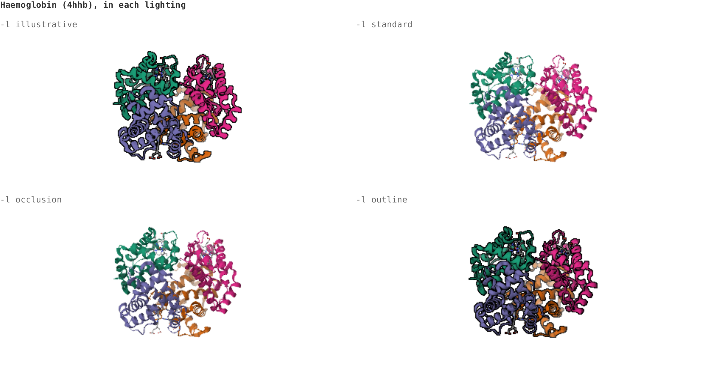

# molterm 3D

Structures in 3D in the terminal, drawn by [Mol*](https://molstar.org/) on a server and shown with Kitty graphics: turn them with the
mouse, zoom with the wheel, step through Mol*'s styles and colours. And a web page with Mol*'s own viewer on the same structures.

A sub-project of molterm, as `visidata-molterm/` is. Mol* runs headless in Node (`HeadlessPluginContext`), on software OpenGL (Mesa's
llvmpipe on a virtual X display), so the server needs no GPU. 3D coordinates for SMILES and molblocks come from the molterm server's
`/api/v1/conformer.sdf`; PDB entries come from RCSB. Author: Shinichiro Wachi.



## Use

```sh
curl -so molterm3d http://molterm-3d-dev.localhost/molterm3d && chmod +x molterm3d
./molterm3d 1crn                       # a PDB entry
./molterm3d 'CC(=O)Oc1ccccc1C(=O)O'    # anything molterm reads, in 3D
./molterm3d -s spacefill ligand.sdf    # a file: PDB, mmCIF, SDF/MOL, MOL2, XYZ
./molterm3d -p -s spacefill 4hhb       # one picture printed into the shell, instead of the viewer
```

http://molterm-3d-dev.localhost/showcase plays it all in a web terminal: see [Showcase](#showcase).

| input | does |
|---|---|
| drag | turns, as a trackball: half a turn across the whole picture |
| right-drag, Shift-drag | moves |
| wheel, middle-drag, `+` `-` | zooms |
| arrows, Shift-arrows | turn 15°, move |
| `s` / `S` | next / previous style: auto, ball-and-stick, spacefill, licorice, cartoon, surface |
| `c` / `C` | next / previous colour: auto, element, chain, secondary, rainbow, residue, b-factor, illustrative |
| `l` / `L` | next / previous lighting: illustrative, standard, occlusion, outline |
| `h` | hydrogens shown or hidden |
| `r` | back to the first view |
| `?` | the keys, on the status line |
| `q`, Esc, Ctrl-C | quit |

Auto draws a protein or nucleic acid as a cartoon, coloured by chain, with its ligands as balls and sticks, and anything else as balls
and sticks with grey carbons. Water is left out of a crystal structure. Options: `-s` style, `-c` colour, `-l` lighting, `-H` hydrogens
hidden, `-t light|dark`, `-k` Kitty graphics whatever the terminal seems to be. The server is `$MOLTERM3D_URL`, or the one the script
came from.

Lighting is Mol*'s postprocessing. **Illustrative**, the default, is Mol*'s style of that name: flat colour, black outlines and ambient
occlusion, after David Goodsell's drawings. In it, a protein drawn as spacefill or a surface takes Mol*'s illustrative colours (each
chain its own, carbons lighter) unless `-c` says otherwise. **Standard** is Mol*'s usual light, with shading and highlights;
**occlusion** adds ambient occlusion to it, **outline** the outlines alone. Each structure starts from Mol*'s "orient axes" view, which
depends on the structure alone, so every style, colour and lighting of it starts from the same side.

`-p` prints one picture where the cursor is and leaves the cursor below it, so the picture scrolls with the shell's text and stays in
the terminal's history, as molterm's own pictures do (through tmux, as placeholder lines). `-r` sets its height in rows (16 by
default); it's 4:3, or as wide as the terminal. The options above apply, and `turn` and `tilt` (degrees) go to `/api/v1/print`.

It needs Kitty graphics: Kitty or Ghostty, or either inside tmux with `allow-passthrough on`, where the picture goes as Unicode
placeholders, as molterm's pictures do (ids are cleared before they're sent again, for Ghostty). Pictures have transparent backgrounds,
so the terminal's own shows through; the background colour the terminal reports is also given to Mol* for its fog.

### How it works

As `molterm edit` does: the client is a shell script that reads the terminal raw and sends each batch of keys and mouse reports, as hex,
to `POST /api/v1/view` with the state from the last answer. The server applies them to the view (a rotation from Mol*'s own starting
view, a zoom and a shift, all in the state), draws the structure at the window's size in pixels with Mol*, and answers
`<0 go on, 1 finished, 2 failed> <state>` and what to print. Pictures alternate between two ids, the new one placed before the old one
is removed, so nothing flickers. A drag costs about 0.1 s on this server for a small protein; the first view of a structure about a
second, as Mol* builds its geometry. From 0.4 s on, a spinner turns at the end of the status line (and on the cursor's line for `-p`),
so a slow picture doesn't look like a hang; the next answer writes the status line again over it.

Speed. Profiled by timing every WebGL call: nearly all of a frame is Mol*'s draw calls, inside Mesa's llvmpipe. Mesh vertices go
through one core; pixels are shaded on all eight. headless-gl leaves `EXT_frag_depth` out of its list though the ANGLE under it has
it, so Mol* drew every atom as a mesh (320 triangles each for 4HHB); the renderer passes the extension on (`gl()` in `renderer.js`),
and Mol* now draws atoms and bonds as impostors, a quad each, shaded as a sphere or cylinder, which look the same. Occlusion is
computed at half the width and height, blurred anyway. While a drag goes on, a structure that took over 150 ms to draw is drawn rough,
with Mol*'s low-quality meshes (cartoons and surfaces are still meshes) and a quarter of the pixels, and in full when the button is up;
keys, the wheel and printed pictures are always in full. PNGs are written with one filter instead of pngjs trying five on every row
(four times faster, a few percent larger), and llvmpipe has as many threads as the container has CPUs (`LP_NUM_THREADS=8`), not the
host's 128.

What a full 1.6-megapixel frame of 4HHB spacefill, illustrative, costs now (0.6 s): shading, mostly per pixel, 0.45 s; reading the
pixels back 0.06 s; the PNG 0.045 s; Mol*'s JavaScript, base64 and the shell client's handling of the 0.9 MB answer (0.03 s) the
rest. A Rust PNG encoder would save about 0.03 s of it, not worth a native module; the rest is Mesa's. What would still pay: more CPUs
(8 took that frame from 0.62 s to 0.42 s, so the cap is now 8), a smaller pixel cap than 1.6 megapixels, or a GPU.

Three Mol* contexts are kept, each with one structure drawn one way; changing style or colour builds it again. Pictures are capped at
1.6 megapixels and the terminal scales them up.

## Web

http://molterm-3d-dev.localhost: a PDB id or a SMILES in Mol*'s viewer (served from the image, no CDN), with the picture the terminal
would get below it, in a chosen style, colour and turn.

| endpoint | gives |
|---|---|
| `GET /api/v1/structure?input=` | the structure's file; `X-Molterm-Format` (`mmcif`, `sdf`, ...) and `X-Molterm-Name` |
| `GET /api/v1/render.png?input=&style=&colour=&lighting=&width=&height=&turn=&tilt=&background=RRGGBB&hydrogens=0` | a picture, transparent where empty |
| `POST /api/v1/view` | one step of the terminal viewer (above); with `box=row,col,rows,cols` it draws only there, as over a spreadsheet, and `title=` names it on the status line |
| `GET`/`POST /api/v1/print?input=&style=&colour=&lighting=&rows=&cols=&cell_width=&cell_height=&turn=&tilt=&placeholders=1` | what `-p` prints, or 400 with the reason |
| `GET /showcase` | the automated demo (below) |
| `GET /api/v1/showcase?part=&cols=&rows=&cell_width=&cell_height=` | `frames` of one part of it (`caption`, `output`, `pointer`, `click`, `key`, `pause`, `scroll`) and `parts`; 400 below 90 by 30 |
| `GET /molterm3d` | the client, with this server as its default |
| `GET /health` | 200 once Mol* has drawn a test molecule at start, 503 (with the reason) if it can't |

## Showcase

http://molterm-3d-dev.localhost/showcase is an automated demo in a web terminal, as molterm's `/showcase` is, in the same
[restty](https://github.com/wiedymi/restty) (Kitty graphics), black on white. It opens haemoglobin in the viewer and turns it with the
mouse, zooms, moves and resets it, then steps through the four lightings and the colours. It opens it again as spacefill and steps
through the styles. Then it shows the lightings side by side, the styles on streptavidin, and lysozyme's solid styles. It opens
imatinib from its SMILES and turns it. Last, six `molterm3d -p` commands print their pictures into a shell until it scrolls, and the
view scrolls back up through them to the first and down again, as a mouse wheel would.

Every frame is real output: the server sends the viewer the mouse reports and keys the client would, through `viewer.step`, and the
printed pictures come from `viewer.print`; the page only prints them and moves a pointer. The demo comes in five parts, drawn for the
page's own grid the first time that grid is asked for and kept for later visitors (24 parts in memory). The first takes about 10 s to
draw on a cold server, and each later part is drawn while the one before it plays. Restyling a structure is the slow part (1 to 5 s
each), and all drawing shares one queue, so a first visit at a new size holds up other viewers for that long. The frames are
gzipped; the first part is about 6 MB before that. restty and DejaVu Sans Mono are fetched and checksummed at build time, the same
versions as molterm's. The page turns off restty's own fitting (`autoResize`): at a fractional pixel ratio (1.1875 was seen) it chose
a larger grid than the one measured, and the frames, drawn for the measured grid, sat in a corner.

## Run

Docker only, from this folder, with the molterm dev server running (it supplies 3D coordinates):

```sh
make dev                 # build and start -> http://molterm-3d-dev.localhost, against the dev molterm server
make test                # the tests, in the container, drawing with Mol* for real
make view INPUT=1crn     # the viewer in this terminal, through the dev server
make build up ENV=prod   # production -> http://molterm-3d.localhost, against http://molterm.localhost
```

The image is built from the repository's root, to share the house stylesheet. Node 22 on Debian; headless-gl is compiled in a
build stage, as it has no prebuilt binary for this Node. Versions are pinned in `package-lock.json`. The container runs `xvfb-run`
under an init (`init: true`: as PID 1, xvfb-run never hears that the display is ready). Dev bind-mounts `src/`, `public/`, `client/`
and `tests/` and restarts on changes (`node --watch`). PDB entries are kept in `data/pdb/` (git-ignored). CPU is capped at 8 and memory
at 3 GB, since software rendering can take a machine.

| path | job |
|---|---|
| `src/server.js` | routes, the page, health |
| `src/viewer.js` | the terminal viewer's steps: input, the view, frames; and printed pictures |
| `src/showcase.js`, `public/showcase.*` | the `/showcase` demo: the script, which drives the viewer as the client would, and the page that plays it |
| `src/renderer.js` | Mol* contexts, styles and colours, the camera, PNGs; headless-gl with `EXT_frag_depth` |
| `src/structures.js` | PDB ids, files, and SMILES via molterm |
| `src/kitty.js` | Kitty graphics and tmux placeholders, as molterm's `server/placeholders.py` |
| `client/molterm3d.sh` | the client |
| `public/` | the web page |

## Verified

- 22 tests then (`make test`): Kitty sequences and ids match molterm's; keys, mouse reports, which way drags and arrows turn, zoom bounds and quitting; a file
  opened, drawn, turned, restyled through tmux placeholders and closed; resizing; the lightings and the default; printed pictures, direct
  and through tmux; health, the served client, page and showcase, SMILES through molterm, PNG sizes, failures.
- `molterm3d -p` run in a container's terminal (with `-k`, as nothing answers the probes there): the picture's sequence and line break,
  and molterm's message and exit 1 for a bad SMILES.
- `/showcase` watched in Chrome from start to end: the viewer turned, zoomed, moved, relit, recoloured and restyled; the four lightings
  from the same side; streptavidin's styles; lysozyme without its water; imatinib; the printed pictures scrolling with the shell and
  still in its history on the way back. No console errors. The lighting choice on the main page draws.
- 25 tests now, with a drag drawn rough and the release in full, `EXT_frag_depth` offered and compiling, and a viewer in a box
  touching nothing outside it. The VisiData plugin uses the box for its 3D viewer (see `visidata-molterm/`).
- With impostors, through the dev URL at 1.6 megapixels: 4HHB spacefill in full 0.58 s (1.3 s with meshes), rough 0.17 to 0.19 s;
  4HHB cartoon in full 0.41 to 0.49 s, rough 0.1 s; 1CRN cartoon in full 0.3 s, rough 0.09 s. At 800 by 480, 4HHB spacefill takes
  0.15 s in full (0.7 s with meshes). Impostor and half-resolution occlusion pictures compared by eye with the mesh ones: the same.
- A drag through the dev URL at 200 by 50 cells of 10 by 20 pixels (1.6 megapixels), 4HHB spacefill: 1.3 s a frame before, 0.15 to
  0.3 s rough, then 1.3 s for the full picture on release; 4HHB cartoon 0.15 to 0.3 s rough, 0.6 s in full. The spinner, run in a pty
  in the container, for the viewer and `-p`; the web page fades the picture and says "Drawing…" until it comes (Chrome, no errors).
- Low quality looks the same as full for cartoons and sticks; mesh spheres got visibly faceted, so it was kept for drags.
- Time to draw each lighting on llvmpipe, 560 by 440: 1CRN cartoon 40 to 60 ms, 4HHB cartoon 180 to 210 ms, 4HHB spacefill 670 to 810 ms.
  Illustrative costs about 15% more than standard.
- Through the dev URL: 1CRN first frame 0.78 s, a drag 0.13 s; a bad SMILES gives molterm's message.
- In Chrome: the page shows 4HHB and caffeine in Mol*'s viewer and the server's picture below, with no console errors.

## Open

- Not yet tried in a real Kitty or Ghostty window, only through the protocol, its tests and restty.
- The showcase needs 90 columns by 30 rows at its smallest font, so it can't start on a phone, and it sizes itself once.
- A state saved before lighting was added (none outlive a session) is drawn in standard light, as it was then.
- SMILES in production need molterm 0.1.3 (with `/api/v1/conformer.sdf`) running there; PDB entries and files work without.
- Full pictures at 1.6 megapixels still take about half a second for a structure like 4HHB, a surface more: the 8 CPUs are the limit.
- The `EXT_frag_depth` shim reaches into headless-gl's `src/javascript/native-gl` to see what ANGLE offers; another version of `gl`
  laid out otherwise falls back to meshes, slower but right.
- A held button with no motion keeps the rough picture until it's released.
- No spinning on its own: the client only asks when something is typed or the window changes.
- One structure at a time per Mol* context and all drawing queued, so many viewers at once will wait on each other.
