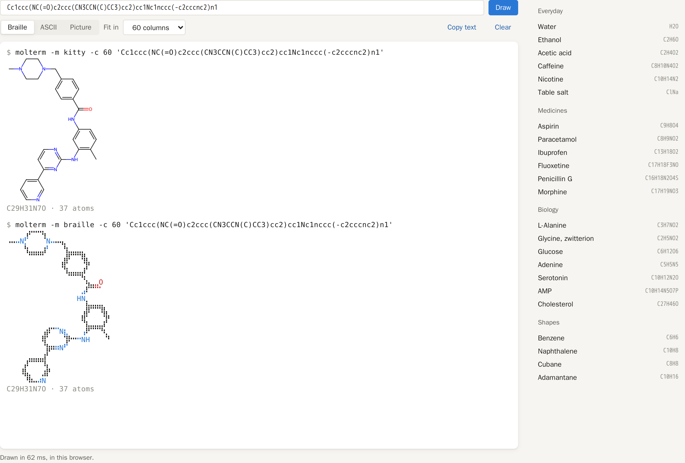

# molterm in the browser

**Live: https://shinwachi.github.io/molterm-web/**



A static page that draws molecules the way molterm does, with no server behind it. RDKit, compiled to WebAssembly
([RDKit.js](https://www.npmjs.com/package/@rdkit/rdkit) 2026.9.1, the same RDKit as the molterm server), reads the SMILES or molblock and
lays it out and draws it. `site/molterm.js` is molterm's text renderer (`server/render.py`, `braille.py`, `octant.py`, `asciiart.py`)
ported to JavaScript, and [restty](https://github.com/wiedymi/restty) shows the result as a terminal would, with Kitty graphics for the
picture mode. nginx only serves the files; everything runs in the visitor's browser.

## Run it

Docker only, from this folder:

```sh
make dev        # build and start -> http://molterm-web-dev.localhost, the page bind-mounted
make test       # the renderer's tests, in Node, against the server's own output
make fixtures   # record that output again from the dev molterm server (site/check.json)
make export     # the whole site as plain files in data/site, for any static host (GitHub Pages, a bucket, ...)
make pages      # publish it to GitHub Pages (github.com/shinwachi/molterm-web, public, the built files only)
make build up ENV=prod   # production -> http://molterm-web.localhost
```

A real domain goes in a git-ignored `env/<env>.local.env`, as for the other services (see the main README).

The image is built from the repository's root, to share the house stylesheet. Its first stage fetches RDKit.js, restty and the DejaVu
fonts from npm, each checked against its sha256; nothing is loaded from a CDN at run time.

| path | job |
|---|---|
| `site/index.html`, `app.js`, `site.css` | the page: SMILES box, samples, display, and the terminal |
| `site/molterm.js` | the renderer: parsing, the drawing's pixels to Braille or octants, labels, ASCII, Kitty sequences |
| `site/rdkit.js` | loads RDKit.js, which is a classic script rather than a module |
| `site/check.html`, `check.js`, `check.json` | every sample drawn here beside the server's rendering of it |
| `tests/molterm.test.mjs` | Node tests: ASCII exactly as the server draws it, formulas, labels, Kitty chunks |
| `tests/fixtures.mjs` | writes `site/check.json` from the server |

## How the port matches the server

- **Atom positions.** The renderer needs where RDKit drew each atom (`GetDrawCoords` on the server), which RDKit.js doesn't offer. RDKit
  draws on a canvas whose context records every `moveTo` and `lineTo` at full precision; the SVG of the same drawing says which line is
  which bond. A single bond's line runs from atom to atom, so the drawing's scale and offset are fitted to those lines, and each atom is
  then moved to the exact point it was drawn at.
- **Layout.** RDKit.js turns a computed layout to its canonical orientation; the server keeps RDKit's first one. So the same SMILES comes
  out turned differently here. The check therefore sends RDKit.js's own molblock to the server, which keeps its coordinates, and both
  render the same layout.
- **Pixels.** The server rasterizes with Cairo, the browser with its own canvas. Their antialiasing differs along the edges of strokes,
  and a dot on the 30% coverage threshold can fall either way.

Verified (2026-11-05): `make test`, 53 tests, all 46 ASCII renderings identical to the server's. In Chrome, `check.html`: 74 of the 92
renderings identical, and every Braille one at least 94% the same, the differences single dots along a stroke. The page draws in all
three displays, Kitty pictures included, in 10 to 90 ms.

## Open issues

- Octants are in the renderer but not on the page: restty's font (DejaVu Sans Mono) has no Unicode 16 octant glyphs.
- No Markush (R-group) structures, editor, themes or fog: only the drawing itself is ported.
- The live copy on GitHub Pages is updated by hand, with `make pages`: it doesn't follow commits here by itself.
